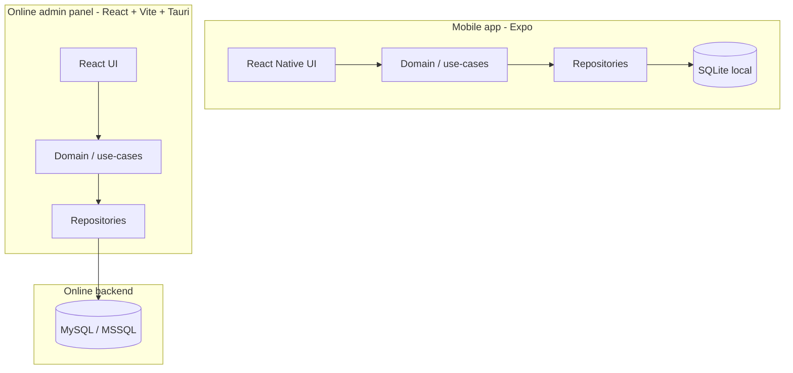
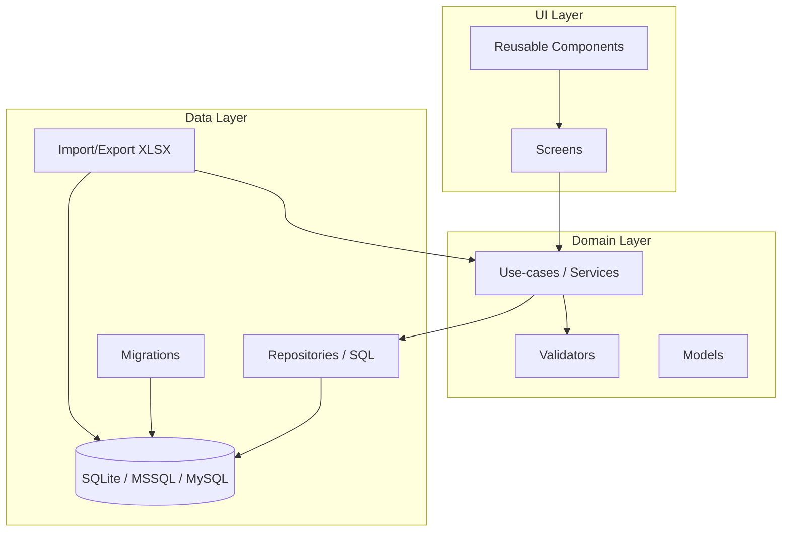
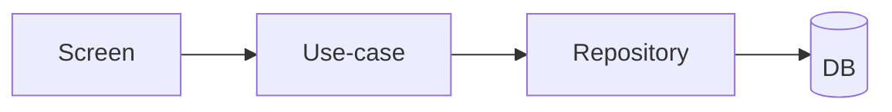

# Architecture

## High-level approach
The app is **offline-first** and uses a **database** as the persistent store. Supported backends:

| Backend | Mode | Use case |
|--------|--------|----------|
| **SQLite** | **Local** | Mobile app (Expo) — on-device file, offline-first, no server |
| **MSSQL** | **Online** | Server / web admin — central DB, multi-user, sync |
| **MySQL** | **Online** | Server / web admin — central DB, multi-user, sync |

**Plug-and-play**: Use **SQLite for local** (single device) and **MySQL or MSSQL for online** (shared server). Same schema and XLSX format; switch backend via config without changing domain or UI logic.

**Two clients**:
- **Mobile app** (Expo, React Native): local SQLite or API → online DB; expense tracking, CRUD, XLSX on device.
- **Online admin panel** (React + Vite + Tauri): desktop app that connects to **MySQL or MSSQL** for user management, bulk data, reports, and XLSX import/export. See [09-admin-panel.md](09-admin-panel.md).

The UI reads/writes data through a thin domain layer; the **data layer abstracts the database** so the same validation rules and use-cases apply regardless of client or engine (SQLite, MSSQL, MySQL).

## System overview (mobile + admin)



*(Mobile uses SQLite locally; admin panel uses MySQL/MSSQL only. Same schema and XLSX format.)*

## Component view (at a glance — per app)


## Logical layers (mobile and admin)
- **UI layer**
  - **Mobile**: React / Expo (React Native); screens, navigation, hooks.
  - **Admin**: **React** + **Vite** inside **Tauri** (desktop); same layering: screens, navigation, form state.
  - Both: form state + validation messages; call domain services (use-cases).

- **Domain layer (use-cases)**
  - Transaction/account/category/user operations
  - Business rules (e.g., transfer creates two legs; amount > 0)
  - Reporting queries (date-range aggregates, category totals)

- **Data layer**
  - **Database abstraction**: one interface (repositories) per engine (SQLite, MSSQL, MySQL).
  - **Mobile**: SQLite via `expo-sqlite`; for online, call backend API or sync service that uses MySQL/MSSQL.
  - **Admin panel**: **MySQL/MSSQL only** — Tauri Rust side uses `mysql` / `tiberius` (or similar) to talk to the server; no SQLite in admin.
  - Migration runner per dialect (see [Data model](03-data-model-sqlite.md)).
  - Import/export adapters (XLSX ↔ domain objects ↔ active DB) in both apps.

## Suggested folder structure (Expo app)
```
src/
  app/                # navigation + screens
  components/         # reusable UI
  domain/
    models/           # TS types for entities
    usecases/         # use-case layer: transactionUseCase, accountUseCase, categoryUseCase, userUseCase, dashboardUseCase
    validators/       # shared validation rules (optional; validation can live in use-cases)
  data/
    db/
      schema/         # migration SQL files (per dialect: sqlite/, mssql/, mysql/)
      client.ts       # DB client factory (SQLite | MSSQL | MySQL)
      migrate.ts      # migration runner (dialect-aware)
    repositories/     # data access — same interface, dialect-specific SQL if needed
    importExport/     # XLSX mapping + IO
  auth/
    session.ts        # session storage + guards
    password.ts       # hashing/verification utilities
  utils/
    dates.ts money.ts ids.ts
```

## Key libraries
- **Mobile (Expo SDK 53)**: `expo-sqlite`, `expo-secure-store`, `expo-file-system`, `expo-document-picker`, `expo-sharing`, `xlsx` (SheetJS). For remote DB: backend API or sync service using `mssql` / `mysql2` (Node).
- **Admin panel (React + Vite + Tauri)**: **React**, **Vite**, **Tauri**; **MySQL** or **MSSQL** via Rust crates (e.g. `mysql`, `tiberius`) on the Tauri side; frontend uses `@tauri-apps/api` to invoke Rust; XLSX via Rust or JS (e.g. SheetJS in frontend, Tauri for file dialogs).

## Runtime flows (high level)
- **App start**
  - Run migrations (schema version → latest)
  - Load session (if exists)
  - Route to Login or Home

- **CRUD**
  - UI → use-case (validation + orchestration) → repository → DB. Screens call use-cases only; use-cases call repositories.



- **Import XLSX**
  - User selects file → parse workbook → validate + preview → write into the active database (SQLite/MSSQL/MySQL) inside a transaction

- **Export XLSX**
  - Query data snapshots from the active DB → build workbook → save to file system → share

## Data integrity guidelines
- Use **FOREIGN KEY** constraints on all engines; on SQLite run `PRAGMA foreign_keys = ON`.
- Use **transactions** for multi-step writes (transfers, import batch) on all backends.
- Use deterministic **UUIDs** for primary keys so schemas and XLSX stay portable across SQLite, MSSQL, and MySQL.

## Error handling strategy
- Domain errors are typed (e.g., `ValidationError`, `AuthError`, `ImportError`).
- UI displays actionable messages; import shows row-level errors.
- Log unexpected errors (device console + optional local debug log file).

## Reporting performance strategy
- Indexes on `transactions(date)`, `transactions(category_id)`, `transactions(account_id)`.
- Precompute optional monthly summaries (v2) if needed; start with query-time aggregates.

