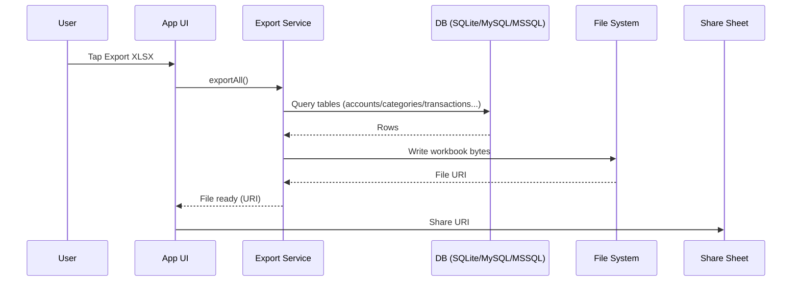
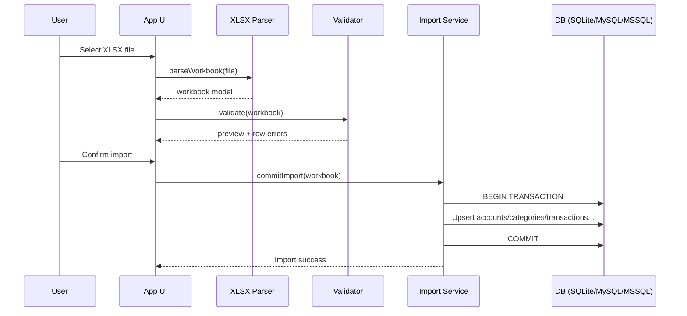

# XLSX import/export

## Goals
- Allow users to **export** their data for backup/reporting.
- Allow users to **import** data back, with validation and conflict handling.
- Keep a **stable, versioned** XLSX format.

## Recommended workbook structure
One workbook with multiple sheets:
- `Meta`
- `Users` (optional; consider admin-only export/import)
- `Accounts`
- `Categories`
- `Transactions`
- `Tags` (optional)
- `TransactionTags` (optional)

Export/import works against the **active database** (local SQLite or online MySQL/MSSQL); same file format for plug-and-play across setups.

## Meta sheet
Purpose: detect format and version.

Columns:
- `key`
- `value`

Required keys:
- `format`: `money-tracker-xlsx`
- `version`: e.g. `1`
- `exported_at`: ISO timestamp

## Sheet schemas
### Accounts
Columns:
- `id` (UUID text)
- `name`
- `type` (optional)
- `currency` (optional)
- `opening_balance`
- `is_archived` (0/1)
- `created_at`
- `updated_at`

### Categories
Columns:
- `id`
- `name`
- `kind` (`expense`/`income`)
- `parent_id` (nullable)
- `is_archived` (0/1)
- `created_at`
- `updated_at`

### Transactions
Columns:
- `id`
- `type` (`expense`/`income`/`transfer`)
- `date`
- `amount`
- `account_id`
- `category_id` (nullable for transfer legs if you keep it null)
- `note` (optional)
- `transfer_group_id` (optional)
- `created_by_user_id` (optional)
- `created_at`
- `updated_at`

---

## Sample XLSX column template (example rows)

Use these as the **exact header row** and 1–2 **example data rows** when generating or parsing XLSX. All dates/timestamps in **ISO8601** (e.g. `2025-02-28T10:00:00.000Z`).

### Sheet: Meta
| key | value |
|-----|--------|
| format | money-tracker-xlsx |
| version | 1 |
| exported_at | 2025-02-28T12:00:00.000Z |

### Sheet: Users (optional)
| id | username | password_hash | role | is_active | created_at | updated_at |
|----|----------|---------------|------|-----------|------------|------------|
| a1b2c3d4-e5f6-7890-abcd-ef1111111111 | admin | $scrypt$... | admin | 1 | 2025-01-01T00:00:00.000Z | 2025-01-01T00:00:00.000Z |
| b2c3d4e5-f6a7-8901-bcde-f12222222222 | john | $scrypt$... | user | 1 | 2025-01-02T00:00:00.000Z | 2025-01-02T00:00:00.000Z |

### Sheet: Accounts
| id | name | type | currency | opening_balance | is_archived | created_at | updated_at |
|----|------|------|----------|----------------|-------------|------------|------------|
| c3d4e5f6-a7b8-9012-cdef-233333333333 | Cash | cash | USD | 100.5 | 0 | 2025-01-01T00:00:00.000Z | 2025-01-01T00:00:00.000Z |
| d4e5f6a7-b8c9-0123-defa-344444444444 | Main Bank | bank | USD | 5000 | 0 | 2025-01-01T00:00:00.000Z | 2025-01-01T00:00:00.000Z |

### Sheet: Categories
| id | name | kind | parent_id | is_archived | created_at | updated_at |
|----|------|------|-----------|-------------|------------|------------|
| e5f6a7b8-c9d0-1234-efab-455555555555 | Food | expense | | 0 | 2025-01-01T00:00:00.000Z | 2025-01-01T00:00:00.000Z |
| f6a7b8c9-d0e1-2345-fabc-566666666666 | Salary | income | | 0 | 2025-01-01T00:00:00.000Z | 2025-01-01T00:00:00.000Z |
| a7b8c9d0-e1f2-3456-abcd-677777777777 | Groceries | expense | e5f6a7b8-c9d0-1234-efab-455555555555 | 0 | 2025-01-01T00:00:00.000Z | 2025-01-01T00:00:00.000Z |

### Sheet: Transactions
| id | type | date | amount | account_id | category_id | note | transfer_group_id | created_by_user_id | created_at | updated_at |
|----|------|------|--------|------------|-------------|------|-------------------|--------------------|------------|------------|
| b8c9d0e1-f2a3-4567-bcde-788888888888 | expense | 2025-02-15T09:00:00.000Z | 45.99 | c3d4e5f6-a7b8-9012-cdef-233333333333 | e5f6a7b8-c9d0-1234-efab-455555555555 | Lunch | | a1b2c3d4-e5f6-7890-abcd-ef1111111111 | 2025-02-15T09:05:00.000Z | 2025-02-15T09:05:00.000Z |
| c9d0e1f2-a3b4-5678-cdef-899999999999 | income | 2025-02-01T00:00:00.000Z | 3500 | d4e5f6a7-b8c9-0123-defa-344444444444 | f6a7b8c9-d0e1-2345-fabc-566666666666 | Feb salary | | a1b2c3d4-e5f6-7890-abcd-ef1111111111 | 2025-02-01T08:00:00.000Z | 2025-02-01T08:00:00.000Z |
| d0e1f2a3-b4c5-6789-defa-900000000001 | expense | 2025-02-16T10:00:00.000Z | 100 | c3d4e5f6-a7b8-9012-cdef-233333333333 | | ATM withdrawal | gg111111-2222-3333-4444-555555555555 | a1b2c3d4-e5f6-7890-abcd-ef1111111111 | 2025-02-16T10:00:00.000Z | 2025-02-16T10:00:00.000Z |
| e1f2a3b4-c5d6-7890-efab-a111111111112 | income | 2025-02-16T10:00:00.000Z | 100 | d4e5f6a7-b8c9-0123-defa-344444444444 | | ATM deposit | gg111111-2222-3333-4444-555555555555 | a1b2c3d4-e5f6-7890-abcd-ef1111111111 | 2025-02-16T10:00:00.000Z | 2025-02-16T10:00:00.000Z |

*(Last two rows are a transfer pair: same `transfer_group_id`, one expense leg, one income leg.)*

### Sheet: Tags (optional)
| id | name | created_at |
|----|------|------------|
| t1a2b3c4-d5e6-7890-1234-567890abcdef | work | 2025-01-01T00:00:00.000Z |
| t2b3c4d5-e6f7-8901-2345-678901bcdefg | personal | 2025-01-01T00:00:00.000Z |

### Sheet: TransactionTags (optional)
| transaction_id | tag_id |
|----------------|--------|
| b8c9d0e1-f2a3-4567-bcde-788888888888 | t2b3c4d5-e6f7-8901-2345-678901bcdefg |

---

## Export flow
1. Query all needed data from the active DB — SQLite (local) or MySQL/MSSQL (online) — stable ordering by created_at or name.
2. Build workbook:
   - Write `Meta` first
   - Write each entity sheet
3. Serialize workbook to a file path in app storage.
4. Share/save via OS share dialog.

## Import flow (two-phase)
### Phase 1: Parse + validate (no DB writes)
1. User selects XLSX (document picker).
2. Parse workbook.
3. Validate `Meta.format` and `Meta.version`.
4. Validate each sheet:
   - required columns exist
   - types/coercions (amount numeric, is_archived 0/1)
   - foreign keys refer to existing rows within the import set or already in DB
5. Show preview + errors:
   - row number
   - field
   - message

### Phase 2: Commit (DB transaction)
1. Begin transaction on the active DB (SQLite local or MySQL/MSSQL online).
2. Upsert strategy per entity (configurable):
   - **By id**: if `id` exists → update; else insert
   - Or **By unique key** (e.g., account name): merge IDs carefully (more complex)
3. Insert/update in dependency order:
   - Accounts → Categories → Transactions → Tags → TransactionTags
4. Commit transaction.
5. Rebuild derived UI caches (if any).

## Conflict strategies
Pick one default and allow override in UI:
- **Strict (recommended for v1)**: ids must not collide with different content; abort import on conflicts.
- **Merge by ID**: existing row with same `id` is updated (last-write wins using `updated_at`).
- **Merge by name** (accounts/categories): if name matches, reuse existing ID and remap references.

## Date/time format
- Prefer ISO8601 in XLSX (string) to avoid Excel’s timezone/date serial pitfalls.

## Security & privacy
- Warn users that export contains sensitive financial data.
- Consider excluding `Users` sheet by default; provide admin-only “Include users in export” toggle.

