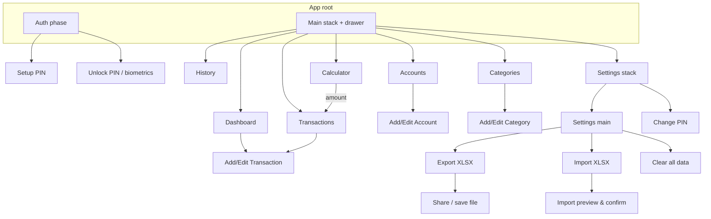

# UI screens & navigation (MYTracker)

## Navigation diagram (Mermaid)

*(Auth phase and Main are mutually exclusive. Lock app returns to Unlock without wiping data.)*

## Navigation structure (actual)
- **Auth phase** (`App.tsx`: `setup_pin` | `unlock`)
  - Setup PIN (first run or after clear data)
  - Unlock (PIN + optional biometrics)
- **Main app: one stack + drawer overlay**
  - Drawer order: Dashboard, Transactions, History, Calculator, Accounts, Categories, Settings.
  - **Settings** nested stack: Settings main → Change PIN.
- **Drawer footer:** Lock app (not logout — session data remains on device).

## User flow
- **First launch:** Setup PIN → optional biometrics → Dashboard.
- **Return visit:** Unlock → Dashboard.
- **Daily use:** Drawer to switch sections; Add transaction from Dashboard or Transactions.
- **Calculator:** Compute amount → navigate to Transactions with pre-filled amount (optional).
- **Settings:** Security, export/import, clear all data.

## Screen list and purpose

| Screen | Purpose |
|--------|---------|
| **Setup PIN** | Create + confirm 4-digit PIN; optional enable biometrics |
| **Unlock** | Enter PIN or use biometrics; lockout after failed attempts |
| **Dashboard (Home)** | Current month KPIs: income, expense, net, tx count, total balance, savings rate, top categories, account balances |
| **Transactions** | Month-scoped list; add/edit/delete; month prev/next |
| **History** | Month-scoped read-only list + income/expense/net banner |
| **Calculator** | Arithmetic with collapsible history |
| **Add/Edit Transaction** | Expense / income / transfer form |
| **Accounts** | List balances; add/edit/archive |
| **Categories** | Income/expense categories; add/edit/archive |
| **Settings** | Instructions, change PIN, biometrics toggle, export/import, clear data |
| **Change PIN** | Verify old PIN, set new PIN |

## Dashboard vs Transactions vs History

| | Dashboard | Transactions | History |
|---|-----------|--------------|---------|
| Period | Current month only | Selected month | Selected month |
| Edit data | No (shortcut to add) | Yes | No |
| Summary | Full KPIs + categories | List only | List + period totals |

Date ranges for all three use `app/src/utils/periods.ts`.

## UX notes
- Confirm destructive actions (delete transaction, archive account/category, clear all data).
- Import: preview + validation before commit.
- Show selected month label on Transactions and History.
- Lock app is explicit in drawer and Settings (personal app — no “logout” wording).

---

## Online admin panel

Separate client — see [09-admin-panel.md](09-admin-panel.md). Not part of the MYTracker mobile navigation above.

## Debugging navigation

If `navigation.navigate` is undefined, the screen must use `useNavigation()` from `@react-navigation/native` (see [10-app-flow-traceability.md](10-app-flow-traceability.md)).
