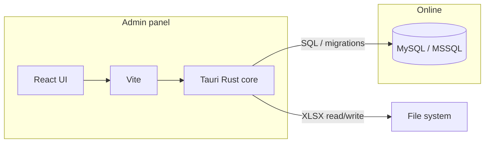
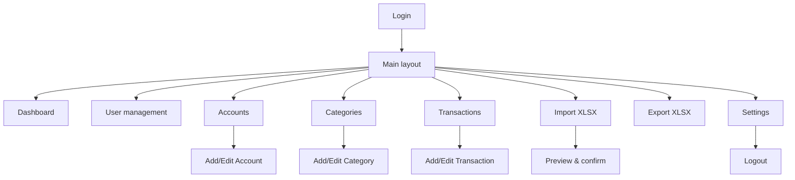

# Online admin panel (React + Vite + Tauri)

## Role in the system

The **online admin panel** is a **desktop application** that connects to **MySQL or MSSQL** (online backend). It complements the **mobile app** (Expo + SQLite local): mobile is for day-to-day tracking; the admin panel is for managing data and users when using an online setup.

| Client | Stack | Database | Use |
|--------|--------|----------|-----|
| **Mobile app** | Expo SDK 53, React Native | SQLite (local) or API → MySQL/MSSQL | Expense tracking, CRUD, export/import on device |
| **Admin panel** | **React**, **Vite**, **Tauri** | **MySQL** or **MSSQL** (online) | User management, bulk data, reports, XLSX import/export |

## Tech stack

- **UI**: **React** (with TypeScript recommended).
- **Build / dev server**: **Vite** (fast HMR, ESM, simple config).
- **Desktop shell**: **Tauri** (native binary, small footprint; frontend = React + Vite; backend = Rust).
- **Database**: **MySQL** or **MSSQL** only (online). No SQLite in the admin app — it always talks to the server DB (direct connection from Tauri’s Rust side, or via a small API if you add one later).
- **Auth**: Same model as mobile (admin/user roles); session stored securely (e.g. in Tauri’s secure storage or via backend session).

## Why Tauri + Vite + React

- **Tauri**: Cross-platform desktop (Windows, macOS, Linux) without Electron’s weight; can call Rust code for DB access or file system (e.g. XLSX save/open).
- **Vite**: Fast React dev experience and optimized production bundles.
- **React**: Reuse patterns and (if desired) share types/validation logic with a future web admin; same domain model as mobile.

## Admin panel features (online)

- **Authentication**
  - Login (username + password) against online DB (or API).
  - Role-based access: **Admin** only for user management and destructive actions; **User** for view/edit own data if you scope by user later.

- **Dashboard (optional)**
  - High-level stats: total users, total transactions, income/expense summary (from MySQL/MSSQL).
  - Date range filter.

- **User management** (admin only)
  - List users (active/disabled).
  - Create user (username, role, password).
  - Disable/enable user.
  - Reset password.

- **Data management**
  - **Accounts**: list, add, edit, archive (CRUD against online DB).
  - **Categories**: list, add, edit, archive; optional parent (same schema as mobile).
  - **Transactions**: list with filters (date, account, category, type); add, edit, delete (and transfer pairs).

- **Import / Export XLSX**
  - **Export**: Same format as mobile (see [06-import-export-xlsx.md](06-import-export-xlsx.md)); export from MySQL/MSSQL to file (Tauri file dialog / save path).
  - **Import**: Select XLSX → validate + preview → write to MySQL/MSSQL in a transaction (same conflict strategies as mobile).

- **Settings / config**
  - DB connection (MySQL or MSSQL) — host, port, database, user, password (store in Tauri config or env; never commit secrets).

## Suggested folder structure (Tauri + React + Vite)

```
admin-panel/
  src-tauri/           # Tauri (Rust) — DB client, optional API, file system
    src/
      main.rs
      lib.rs            # DB connection (mysql/mssql driver), commands for CRUD
    Cargo.toml
  src/                  # React + Vite frontend
    app/                # routes / navigation
    components/
    pages/              # Dashboard, Users, Accounts, Categories, Transactions, Import/Export, Settings
    api/                # calls to Tauri invoke() for DB operations
    hooks/
    utils/
  package.json          # React, Vite, @tauri-apps/api
  vite.config.ts
  index.html
```

- **Frontend**: React + Vite; uses `@tauri-apps/api` to `invoke()` Rust commands (e.g. `get_users`, `create_transaction`, `export_xlsx`).
- **Backend (Rust)**: Open MySQL or MSSQL connection; run migrations; expose commands that execute SQL and return JSON; optionally write/read XLSX files on disk for import/export.

## Data flow (high level)



- React → `invoke('command_name', payload)` → Tauri (Rust) → MySQL/MSSQL or file system → response back to React.

## Navigation (admin panel)

- **Login** → (success) → **Main layout** (sidebar or top nav).
- **Main**
  - Dashboard (optional)
  - Users (admin only)
  - Accounts
  - Categories
  - Transactions
  - Import XLSX / Export XLSX
  - Settings (e.g. DB connection, logout)



Same domain rules as mobile (transfers as two legs, validations, etc.); only the client (React + Tauri) and the fact it always uses MySQL/MSSQL differ.

## Plug-and-play with mobile

- **Mobile**: Local SQLite or (if you add an API) sync with the same MySQL/MSSQL.
- **Admin**: Always online (MySQL/MSSQL); same schema and XLSX format as in [06-import-export-xlsx.md](06-import-export-xlsx.md).
- Deploy: run the Tauri app on a machine that can reach the MySQL/MSSQL server; configure connection in Settings or env.
