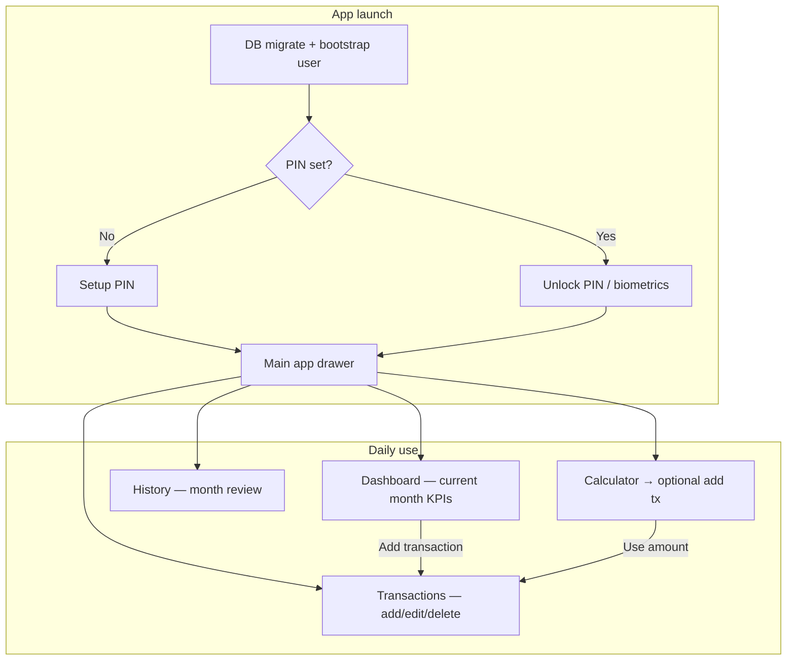
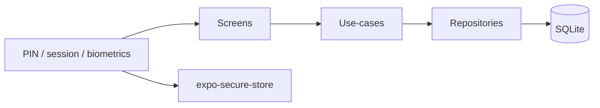
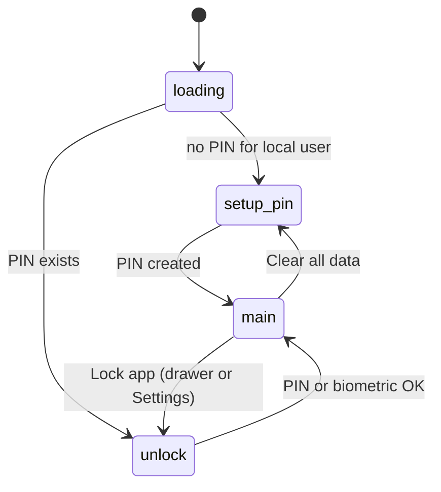

# MYTracker — App flow & problem traceability

This document is the **runbook** for MYTracker (personal money tracker). Use it when something breaks, when metrics look wrong, or when you need to change behavior without hunting through the codebase.

**Related docs:** [07-ui-screens.md](07-ui-screens.md) (navigation), [02-architecture.md](02-architecture.md) (layers), [05-crud-flows.md](05-crud-flows.md) (CRUD rules), [04-auth-roles.md](04-auth-roles.md) (PIN & lock).

---

## 1. Product intent (personal app)

| Principle | What it means |
|-----------|----------------|
| Single user, single device | No username/password login; one local user auto-created on first run |
| Privacy gate | 4-digit PIN (+ optional biometrics) protects the app on the device |
| Offline-first | All data in SQLite; no cloud sync in v1 |
| Analyst-friendly | Dashboard and History expose income, expense, net, balances, and category breakdown |

---

## 2. End-to-end user journeys

### Screen roles (avoid confusion)

| Screen | Purpose | Period |
|--------|---------|--------|
| **Dashboard (Home)** | KPI snapshot: income, expense, net, transaction count, total balance, savings rate, top categories | **Current calendar month only** |
| **Transactions** | Operational list: add, edit, delete for selected month | Month selector (prev/next) |
| **History** | Read-only month review with income/expense/net banner | Month selector |
| **Accounts / Categories** | Master data for transactions | N/A |
| **Settings** | Security (PIN, biometrics), export/import, clear data | N/A |

**Rule:** Dashboard always uses `getCurrentMonthRange()` from `app/src/utils/periods.ts`. Transactions and History use the same helper for their selected month so date boundaries stay consistent.

---

## 3. Technical flow (layers)

| Layer | Path | Responsibility |
|-------|------|----------------|
| Entry & nav | `app/App.tsx` | Auth gate, drawer, stack routes |
| UI | `app/src/app/screens/*.tsx` | Display, user input, navigation |
| Use-cases | `app/src/domain/usecases/*.ts` | Business rules, orchestration |
| Repositories | `app/src/data/repositories/*.ts` | SQL queries |
| DB | `app/src/data/db/*` | Migrations, bootstrap, clear |
| Auth | `app/src/auth/*` | PIN, session, biometrics, local user |
| Shared utils | `app/src/utils/periods.ts` | Month date ranges (single source of truth) |

**Data rule:** Screens should call **use-cases**, not repositories directly (except type imports).

---

## 4. Metric definitions (data analyst reference)

All period metrics filter `transactions.date` with **inclusive** `from` and `to` ISO timestamps from `getMonthRange(year, month)`.

| Metric | Formula / SQL logic | Source |
|--------|---------------------|--------|
| **Income** | `SUM(amount)` where `type = 'income'` | `transactionRepository.getSumByTypeAndDateRange` |
| **Expense** | `SUM(amount)` where `type IN ('expense', 'transfer')` | Same |
| **Net** | `income - expense` | `dashboardUseCase.getMonthSummary` |
| **Savings rate %** | `(net / income) × 100`, rounded to 1 decimal; `null` if income = 0 | `dashboardUseCase.getDashboardData` |
| **Transaction count** | `COUNT(*)` in date range | `transactionRepository.getTransactionCountForRange` |
| **Account balance** | Starting balance + signed sums per account (income adds, expense/transfer out subtracts) | `accountRepository.getAccountBalance` |
| **Total balance** | Sum of all active account balances | `dashboardUseCase.getDashboardData` |
| **Top categories** | Top N expense categories by `SUM(amount)` in range | `transactionRepository.getTopCategoriesByExpense` |

### Transfer handling

- Transfers create paired rows linked by `transfer_group_id`.
- **Expense side** of transfers counts toward **expense** totals (outflow from source account).
- **Income side** counts toward income on destination account for balance, but dashboard **expense** aggregate includes transfer type on the outflow leg.

If transfer totals look wrong, inspect `getSumByTypeAndDateRange` and transfer creation in `transactionUseCase` / `AddEditTransactionScreen`.

---

## 5. Auth & session flow

| Concern | File(s) |
|---------|---------|
| App auth gate | `app/App.tsx` (`authPhase`: loading \| setup_pin \| unlock \| main) |
| Auto local user | `auth/localSession.ts`, `data/db/bootstrap.ts` |
| PIN hash & lockout | `auth/pin.ts` |
| Biometrics | `auth/biometric.ts`, `UnlockScreen.tsx`, `SetupPinScreen.tsx` |
| Session in SecureStore | `auth/session.ts` |
| Lock (not wipe) | Drawer / Settings → clears in-memory unlock only |
| Clear all data | `data/db/clearData.ts` → wipes DB + PIN → back to setup_pin |

---

## 6. Problem → where to look (traceability matrix)

Use this table first when debugging or planning a change.

| Symptom or change request | Check these files (in order) |
|---------------------------|----------------------------|
| App stuck on loading spinner | `App.tsx` (bootstrap), `data/db/migrate.ts`, `auth/localSession.ts` |
| PIN won't accept / lockout | `auth/pin.ts`, `UnlockScreen.tsx`, SecureStore permissions |
| Biometrics not offered | `auth/biometric.ts`, `app.json` Face ID string, device settings |
| Wrong month on dashboard | `utils/periods.ts`, `HomeScreen.tsx`, `dashboardUseCase.ts` |
| Dashboard numbers wrong | `transactionRepository.getSumByTypeAndDateRange`, `accountRepository.getAccountBalance`, transfer rows in DB |
| Transactions list empty / wrong month | `TransactionsScreen.tsx`, `transactionUseCase.getTransactionList`, `periods.ts` |
| Can't add/edit transaction | `AddEditTransactionScreen.tsx`, `transactionUseCase.ts`, category/account active flags |
| Transfer balance off | `transactionUseCase` (transfer pair), `deleteTransferGroup`, both legs in `transactions` |
| History summary ≠ dashboard (same month) | Both should use same `getMonthRange`; compare `HistoryScreen` vs `getSumByTypeAndDateRange` |
| Account balance wrong | `accountRepository.getAccountBalance`, starting balance on account, transaction types |
| Export/import broken | `SettingsScreen.tsx`, XLSX modules under `data/` or `domain/`, [06-import-export-xlsx.md](06-import-export-xlsx.md) |
| Clear data didn't reset PIN | `clearData.ts`, `hasPinForUser` in `App.tsx` |
| Navigation error (`navigate` undefined) | Screen must use `useNavigation()` hook, not props from `App.tsx` render |
| `nowISO` or date errors | `AddEditTransactionScreen.tsx` imports, `utils/dates` if present |

---

## 7. Module map (by feature)

### Transactions CRUD
1. UI: `TransactionsScreen.tsx`, `AddEditTransactionScreen.tsx`
2. Use-case: `domain/usecases/transactionUseCase.ts`
3. Repo: `data/repositories/transactionRepository.ts`
4. Rules: [05-crud-flows.md](05-crud-flows.md)

### Dashboard / analytics
1. UI: `HomeScreen.tsx`
2. Use-case: `domain/usecases/dashboardUseCase.ts`
3. Repos: `transactionRepository.ts`, `accountRepository.ts`
4. Periods: `utils/periods.ts`

### Accounts & categories
1. UI: `AccountsScreen.tsx`, `CategoriesScreen.tsx`
2. Use-cases: `accountUseCase.ts`, `categoryUseCase.ts`
3. Repos: `accountRepository.ts`, `categoryRepository.ts`

### Settings & data lifecycle
1. UI: `SettingsScreen.tsx`, `ChangePinScreen.tsx` (if present)
2. Clear: `data/db/clearData.ts`
3. Export: search `exportXLSX` in `app/src`

---

## 8. Change checklist

Before merging a behavior change:

1. **Update this doc** if you add a metric, screen, or changes date/auth logic.
2. **Update** [07-ui-screens.md](07-ui-screens.md) if navigation or screen purpose changes.
3. **Update** [05-crud-flows.md](05-crud-flows.md) if validation or CRUD rules change.
4. **Prefer use-cases** for new business logic; keep SQL in repositories.
5. **Use `periods.ts`** for any new date-range filter (do not duplicate month math).
6. **Manual test path:** Setup PIN → add account → add income/expense → check Dashboard vs History for same month → lock → unlock → export.

---

## 9. Known limitations (v1)

- Dashboard does not support custom date ranges (only current month).
- No multi-currency conversion; amounts are stored as numbers.
- Single device; no sync conflict resolution.
- Admin panel / online DB described in other docs is **not** wired to this mobile build.

---

## 10. Document history

| Date | Change |
|------|--------|
| 2026-09-01 | Initial MYTracker flow doc: PIN auth, metrics definitions, traceability matrix, shared `periods.ts` |
